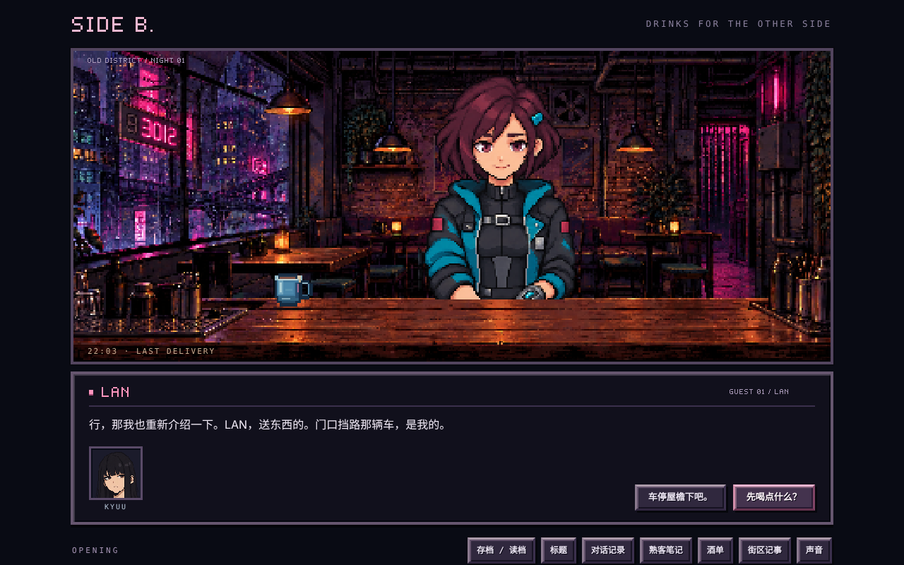
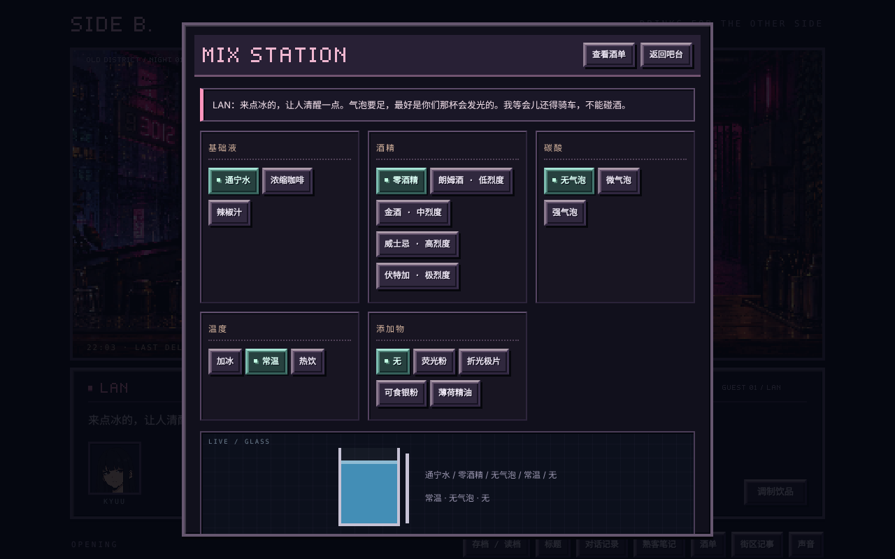
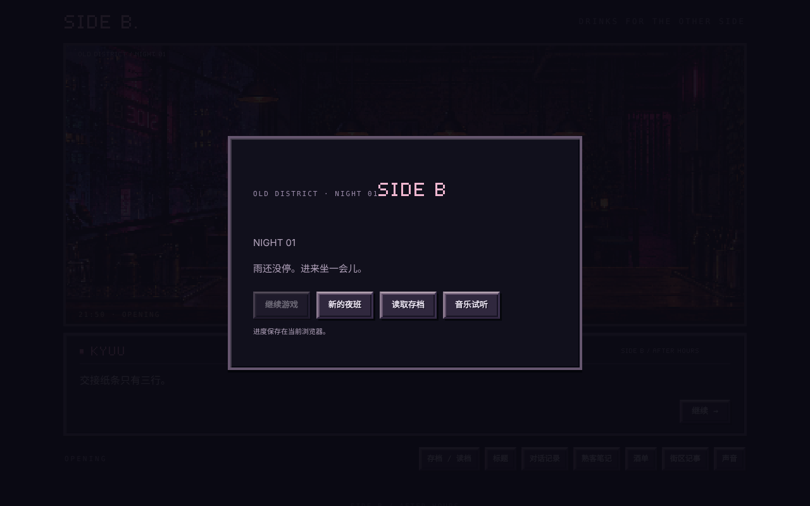

# SIDE B

> 雨夜、旧街区、一间只在夜班营业的酒吧。你调的每一杯酒和说出口的每一句话，都会改变熟客们的故事。

像素风剧情互动游戏。玩家扮演夜班调酒师 KYUU，在雨夜接待熟客，通过对话选择和调饮推进剧情；角色对你的信任和你做过的决定，会把故事带向 4 种不同的结局。

**▶ [在线试玩](https://yuri-1.github.io/SIDEB)**　｜　浏览器打开即玩，无需安装



| 调饮台 | 标题界面 |
|---|---|
|  |  |

---

## 项目规模

| 剧情节点 | 结局 | 角色 | 关系事件 | 饮品 | 自动化检查 |
|:---:|:---:|:---:|:---:|:---:|:---:|
| 237 | 4 | 4 | 8 | 10 | 79 项 |

## 玩法特点

- **多分支剧情**：每个角色有隐藏的信任度，再加上剧情标记（比如是否知情、是否同意公开资料），共同决定剧情走向和结局。
- **调饮玩法**：从基础液、酒精、碳酸、温度、添加物五类材料中组合，共 10 款饮品；调错时，不同角色会有不同的拒收反应。调错不影响剧情和信任度，可以重新调。
- **存档系统**：3 个手动存档位加自动存档，带版本号和旧存档迁移；能识别损坏的存档。
- **声音**：背景音乐和雨声由 Web Audio 实时合成，交互音效（加冰、确认、成功等）为独立的音频文件，可单独调节音量。
- **像素表现**：角色立绘表情、端杯演出、像素 UI 全部用 Canvas 和 CSS 实现，不依赖游戏引擎。

## 我是怎么做的：与 AI 协作开发

这个项目是我主导设计、和 AI 协作完成的。分工如下：

| 我负责 | AI 负责 |
|---|---|
| 世界观、4 个角色设定、剧情分支规则和 4 种结局走向 | 根据我给的方向生成对白初稿（由我逐段修改定稿） |
| 玩法设计：调饮规则、信任度如何影响剧情 | 编写游戏代码 |
| 决定测什么：规划 15 组测试场景 | 根据测试场景编写测试脚本 |
| 对照设计逐项验收，发现问题并准确描述给 AI | 根据描述修复问题 |
| 打包、部署和发布 | 生成像素素材和音效 |

我的工作方式是：**先写清楚设计，让 AI 实现，再亲自玩、对照设计找差异，最后把差异变成自动化测试。**开发过程中，通过逐项验收发现并推动修复了约 10 个"设计和实际表现不一致"的问题。

### 一个例子：从手动发现到自动化防护

1. **发现**：设计里，往杯子里加冰块时应该有音效，但实际玩的时候没有声音。
2. **修复**：我把"原本的设计"和"实际的游玩体验"分别描述给 AI，定位问题并修好。
3. **防护**：把"加冰音效会触发、且不会重复播放"加进自动化测试，以后再改代码，这个问题不会悄悄回来。

### 一个例子：打包后游戏玩不了

用 Electron 打包成 macOS 应用后，画面能正常显示，但交互全部失效。排查后发现，打包配置是逐个列出要打包的文件，漏掉了存放调饮、上酒、音效等交互逻辑的 `scripts/` 目录。补全打包清单后恢复正常。

## 测试

两个测试脚本，共 15 组场景、79 项检查，全部运行不到 1 秒：

```bash
node tests/state.test.cjs
node tests/audio-sfx.test.cjs
```

覆盖内容：

- **存读档**：手动存档位、对话和选择的恢复、调饮进度的恢复、存储空间不足、损坏数据
- **剧情**：4 种结局都能走到、多角色信任度门槛、分支状态持久化、重复选择不会重复生效
- **存档迁移**：旧版本存档升级后，进度和信任度不丢失
- **调饮**：10 款饮品都能正确调出；错误成品对 4 个角色都不会改变剧情和信任度
- **音效**：加冰音效触发且不重复、成功音效只在正确完成时播放一次

## 运行

**在线**：直接访问 [yuri-1.github.io/SIDEB](https://yuri-1.github.io/SIDEB)。

**本地**：直接用浏览器打开 `index.html`，或者：

```bash
python3 -m http.server 8765 --bind 127.0.0.1
# 访问 http://127.0.0.1:8765
```

存档保存在浏览器的 localStorage 里，请固定使用同一个地址、端口和浏览器。

**桌面版（Electron）**：

```bash
npm install
npm start          # 开发模式
npm run build      # 打包 macOS dmg，输出到 dist/
```

## 技术栈

HTML / CSS / 原生 JavaScript（无框架）· Canvas · Web Audio · Node.js（测试）· Electron + electron-builder（打包）· GitHub Pages（部署）

## 目录结构

| 路径 | 说明 |
|---|---|
| `index.html` | 游戏主体与状态逻辑 |
| `narrative.js` / `expansion.js` | 剧情数据与扩展事件 |
| `scripts/` | 饮品、音频、端杯演出、头像等交互模块 |
| `pixel-ui.css` / `pixel-ui.js` | 像素风 UI |
| `assets/` | 立绘、场景、饮品图片与音效 |
| `main.js` | Electron 入口 |
| `tests/` | 状态与音效测试 |

---

## English Summary

**SIDE B** is a pixel-art narrative game about a night-shift bartender in a rainy old district. Player choices and drink-mixing shape hidden trust values and story flags, leading to 4 different endings across 237 story nodes.

I designed the world, characters, branching rules and gameplay, and built the game in collaboration with AI: AI wrote the code and dialogue drafts, while I directed the design, edited all dialogue, planned 15 test scenarios (79 automated checks), verified every feature against the design, and handled packaging and deployment.

**▶ [Play online](https://yuri-1.github.io/SIDEB)**
